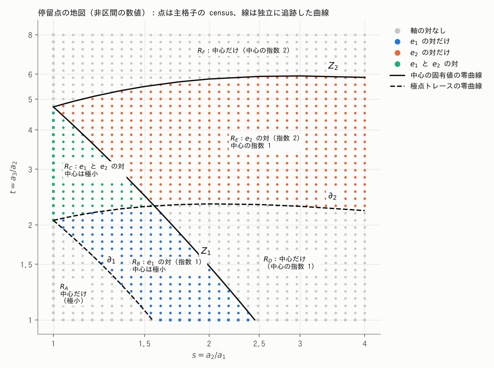
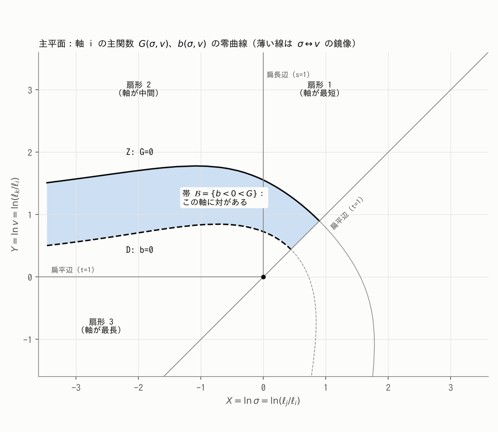

# 報告書｜体積を保つ三軸楕円体の族：停留点の構造の定式化と、最初の地図

2026-11-20 ／ 扱い：DIAGNOSTIC_ONLY / NOT_EVIDENCE ／ 数値はすべて非区間（倍精度浮動小数点）
作成：Claude Code（cloud session）。Codex 宛ての指示書を、ユーザーの依頼で並行して実行したものである。
branch：`ccr-1e5ce365-5ksfyr`（この作業専用）。置き場所：`diagnostics/triaxial_map_20261120/`

この報告書では、**数値の結果**と**証明した事実**を節ごとに分けて書く。§2 と §3 は数値の結果、§4 は証明した事実、§5 は提案である。

---

## 0. 結論

### 0.1 先に知らせること

- 指示書が前提とする branch `evidence/c-gap2-freeze-20261115`（commit `6b1bc9e`）は、この session が読める remote に存在しなかった。V49〜V51 と D-OB 系の報告は読めていない。
- そのため、式は E の定義（論文 I の定義）から独立に導出した。V49〜V51 の「鏡映の補題」「軸方向の凹性の補題」と、ここで提案する補題が同じものかどうかは、照合できていない。
- 辺の上の 4 つの臨界値は、独立に再現できた（§2.1）。

### 0.2 数値の結果（非区間）

窓 1 ≤ s ≤ 4、1 ≤ t ≤ 8 の 33×41 格子（1353 形）で census を取り、曲線は格子と独立に s ≤ 32 まで追跡した。

1. **中心以外の停留点は、すべて e₁ 軸（最短）か e₂ 軸（中間）の上にある。** 座標面の内部、一般の位置、e₃ 軸（最長）の上には、1 個も見つからなかった。
2. **軸 e_i（i=1,2）の上の対は、あっても 1 組である。** 対があることと、中心の固有値 h_i と極点トレース b_i = E_i(e_i) が h_i > 0 > b_i を満たすことが、格子の全点で一致した。
3. **分岐集合は 4 本の曲線である**（図 1）。
   - Z₁：h₁ = 0。扁長辺の (1, λ_c^pro) と扁平辺の (1/λ_c^ob, 1) を結ぶ。
   - ∂₁：b₁ = 0。扁長辺の (1, λ_b^pro) と扁平辺の (1/λ_∂^ob, 1) を結ぶ。
   - Z₂：h₂ = 0。(1, λ_c^pro) から出て s → ∞ へ伸びる。
   - ∂₂：b₂ = 0。(1, λ_b^pro) から出て s → ∞ へ伸びる。
4. **指数。** e₁ の対は指数 1、e₂ の対は指数 2 である。窓の中では h₁ < h₂ < h₃、h₃ > 0 で、中心の指数は 0、1、2 のどれかになる。
5. **境界。** 全勾配のトレースが零になるのは、∂₁ の上での極 ±e₁ と、∂₂ の上での極 ±e₂ だけである。E を単位球面に制限した関数の臨界点は、格子の内部の 1280 形のすべてで、6 個の極だけだった。
6. **予想は確かめられた。** 扁長側の停留円は e₁ 軸の対と e₂ 軸の対に分かれ、型が異なる。さらに、e₁ 軸の対は扁平側の軸の対と同じ一つの族である。



図 1：楔 (s, t) の上の地図。点は主格子の census、線は独立に追跡した曲線である。図 2（`fig/fig2_master_plane.png`）は主平面での帯、図 3（`fig/fig3_far.png`）は Z₂ と ∂₂ の遠方での動き、図 4（`fig/fig4_axis_branches.png`）は軸の上の対の位置である。

### 0.3 証明した事実（§4）

- 定理 1：球の近くでは、停留点は中心だけである（境界のトレースの零点もない）。論文 I 1-1（球）の 3 つの定理を使う定性的な定理で、近傍の大きさは与えない。
- 命題 2：主関数と鏡映の原理。h₁, h₂, h₃ は 1 つの関数 G の 3 つの制限であり、Z₂ は Z₁ の解析接続の鏡像である。∂ についても同じ。
- 命題 3：**せん断の恒等式（新しい式）。** q_iE_j − q_jE_i = (ℓ_j/ℓ_i − ℓ_i/ℓ_j)·T_ij。T は形の一次変分のテンソルである。
- 命題 4：構造定理（条件付き）。3 種類の不等式から、§0.2 の 1、2、4、5 がすべて従う。
- 命題 5：扁長辺の近くでの停留円の分裂（条件付き）。スカラーの不等式 τ(t) ≠ 0 から、ちょうど 4 点への分裂と指数が従う。
- 命題 6：角 (1, λ_c^pro) の近くでの Z₁、Z₂ の存在と一意性。論文 I 1-2 の認証済みの Q′(a_c) < 0 を使う。

### 0.4 証明の設計（§5）

地図を定理にするには、命題 4 の 3 種類の不等式と、2 次元の符号の条件を示せばよい。高次元の箱で勾配の非零を直接覆う必要はない。一番難しいのは、最長軸方向の不等式（基点 3 次元＋形 2 次元）と、無限遠での一様性である。なお、3 種類の不等式のうち (H12) は窓の中でだけ成り立ち、遠方（R_F の奥）では破れる（§2.7）。

---

## 1. 定式化

### 1.1 汎関数と参照球の表示

L = diag(ℓ₁, ℓ₂, ℓ₃)、K = L(B³)、基点 p = Lq（q は参照球）、境界点 x = Lξ（ξ ∈ S²）とする。⟨·⟩ は S² の上の平均である。

```text
k = 1 − q·ξ,   D = |L(ξ − q)|,   B = |L⁻¹ξ|²,   γ = k/(D√B) = cos α,   E(q) = ⟨k α²⟩
u = L(ξ − q)/D（弦の単位方向）,   ν = L⁻¹ξ/√B（外向き単位法線）,   γ = u·ν
```

**物理的な定義との一致（証明）。** 論文 I の定義は E_K(p) = ∫ α² dμ、α = arccos((x−p)·ν/|x−p|)、dμ = (x−p)·ν dA/(3 Vol) である。x = Lξ では ν = L⁻¹ξ/√B、(x−p)·ν = (ξ−q)·ξ/√B = k/√B、|x−p| = D、dA = det L·√B dσ、3 Vol = 4π det L となる。よって dμ = k dσ/(4π)、cos α = k/(D√B) である。∎

数値の照合：物理的な定義をそのまま求積した独立の実装（`code/ref_physical.py`）との差は、12 個の乱数の点で最大 2.2e-9 だった（`out/check_formulas.json`）。

相似変換は構造を変えないので、L = diag(1, s, st) を使う。体積 1 の半軸は a = (1, s, st)/(s²t)^{1/3} である。

### 1.2 勾配のトレースと Hessian

F(γ) = arccos²γ とし、次の 3 つの核を使う。

```text
J(α) = −(F + γF′) = −α² + 2α cot α          J(0) = 2,   J(π/2) = −π²/4
K(α) = −γ²F′     = 2α cos²α / sin α         K(0) = 2,   K(π/2) = 0
A(α) = γ dJ/dγ = dK/dγ = 2 cot α (α + α/sin²α − cot α)      A(0) = 10/3
```

**勾配。**

```text
E_i = ⟨ ξ_i J − ℓ_i √B u_i K ⟩
```

**Hessian（|q| < 1）。**

```text
E_ij = ⟨ −ξ_iξ_j A/k + (ξ_i ℓ_j u_j + ℓ_i u_i ξ_j) A/D − ℓ_iℓ_j u_i u_j √B (γA + K)/D + δ_ij ℓ_i² √B K/D ⟩
```

導出：∂_j k = −ξ_j、∂_j D = −ℓ_j u_j、∂_j γ = γ(ℓ_j u_j/D − ξ_j/k)、∂_j u_i = (u_i ℓ_j u_j − ℓ_i δ_ij)/D を使う。対称性は恒等式 γJ′ = K′ から出る。

**境界への延長（補題 0、証明）。** J と K は [0, π/2] の上で有界で連続である。|q| ≤ 1、ξ ≠ q なら k ≥ 0、D > 0、0 ≤ γ ≤ 1（Cauchy–Schwarz：k = L(ξ−q)·L⁻¹ξ）なので、勾配の被積分関数は有界で、(q, L) について ξ ≠ q で連続である。優収束定理から、勾配の式は閉球 × {L} の上の連続なベクトル場 V(q; L) を定める。|q| < 1 では V = ∇E である。|q| = 1 での V を**勾配のトレース**と呼ぶ。∎

数値の照合：勾配と差分の差 1.1e-7、Hessian と差分の差 2.5e-7（差分の刻み 1e-4 による）、境界のトレースと内側 1 − 10⁻ᵐ での値の差は 10⁻ᵐ に比例した（`out/check_formulas.json`）。

### 1.3 中心の固有値

q = 0 では k = 1、D = |Lξ|、γ = 1/(D√B)、K/γ = 2α cot α である。対称性から Hessian は対角になる。

```text
h_i = ⟨ ξ_i² A (2ℓ_i²/D² − 1) − ℓ_i⁴ ξ_i² (A + 2α cot α)/D⁴ + 2 ℓ_i² α cot α / D² ⟩
```

被積分関数は x_i = ξ_i² だけの関数である（D² = Σℓ_i²x_i、B = Σx_i/ℓ_i²）。球面の測度は単体 {x₁+x₂+x₃ = 1} の上の Dirichlet(½,½,½)、密度 (2π)⁻¹(x₁x₂x₃)^{−1/2} に移る。

- 回転楕円体では D と B が 1 つの x_i だけで決まり、1 次元の積分に戻る。
- 三軸では、D² と B が独立な 2 つの一次式なので、一般には 2 次元のままである。1 次元への簡約は見つからなかった。ただし被積分関数は解析的で、求積はスペクトル的に収束する。

辺での確認：L = diag(1,1,t) での h₁ の零点は 4.72438340452114 で、認証済みの a_c = 4.72438340452113340672…（`CERTIFICATES/prolate/local_bifurcation/`）と 14 桁で一致した。

### 1.4 対称性、主関数、形の平面（指示書 §3 への追加の提案）

- **D₂h。** 3 つの座標面での鏡映で E は不変である。停留集合は閉じた第一八分円に制限してよい。軸の上の点では Hessian は対角になる。
- **置換と斉次性。** 軸の番号の置換 P について E(PLP⁻¹; Pq) = E(L; q) であり、E は ℓ について 0 次の斉次である。

そこで、軸 1 を特別扱いした**主関数**を、(σ, v) ∈ (0, ∞)² の上で定義する。

```text
G(σ, v)    = E_11(0;     diag(1, σ, v))        中心の固有値
g(r; σ, v) = E_1(r e₁;   diag(1, σ, v))        軸の上の勾配,   κ(r; σ, v) = g/r
b(σ, v)    = g(1; σ, v) = κ(1; σ, v)           極点トレース
```

どれも σ ↔ v で対称である。楔 (s, t) ∈ [1, ∞)² の上の量は、主関数の制限になる。

| 軸 | 主平面での位置 (σ, v) | (X, Y) = (ln σ, ln v) での扇形 |
|---|---|---|
| e₁（最短） | (s, st) | 0 ≤ X ≤ Y |
| e₂（中間） | (1/s, t) | X ≤ 0 ≤ Y |
| e₃（最長） | (1/(st), 1/t) | X ≤ Y ≤ 0 |

つまり h₁ = G(s, st)、h₂ = G(1/s, t)、h₃ = G(1/(st), 1/t) であり、g_i と b_i も同じである。3 つの扇形は半平面 X ≤ Y を埋める。扁長辺 s = 1 は X = 0（Y ≥ 0）、扁平辺 t = 1 は対角線 X = Y ≥ 0 と半直線 Y = 0（X ≤ 0）、球は原点である。

この形にすると、軸に関する地図は「主平面の上の 1 本の帯」になる（§3、図 2）。



### 1.5 せん断のテンソル（新しい式）

一般の可逆な行列 L についても、同じ式で E(L; q) を定義する（ν = L⁻ᵀξ/|L⁻ᵀξ|）。次の対称でトレース 0 のテンソルを定義する。

```text
T(q; L) = ⟨ 2 k α cot α ( u⊗u − ν⊗ν ) ⟩
```

- (S1) 任意の 3×3 行列 Δ について d/dε E((I + εΔ)L; q)|₀ = Σ_ab T_ab Δ_ab（q は固定）。
- (S2) ∂E/∂ℓ_i = T_ii/ℓ_i（q は固定）。
- (S3) **q_i E_j − q_j E_i = (ℓ_j/ℓ_i − ℓ_i/ℓ_j) T_ij**。閉球の上で、勾配のトレースについても成り立つ。

証明は §4 の命題 3 にある。T_ij は q_i と q_j について奇関数なので、**余因子** C_ij = T_ij/(q_i q_j) は滑らかに延長できる。(S3) は次の形になる。

```text
E_j/q_j − E_i/q_i = (ℓ_j/ℓ_i − ℓ_i/ℓ_j) C_ij
```

この式の要点は、回転対称で左辺が恒等的に 0 になる辺（ℓ_i = ℓ_j）でも、余因子 C_ij は退化しないことである。辺の近くの薄い層で (s−1) による割り算をする必要がなくなる。

数値の照合（`code/shear.py`、核の勾配のコードとは独立に numpy で実装）：(S3) の両辺の差は最大 1.2e-11（境界の点を含む）、(S2) と差分の差は 9.6e-10、tr T は 1.3e-14 だった（`out/check_shear.json`）。

### 1.6 求積と適用範囲

- **log-chord 座標。** q̂ = q/|q| を軸に、ξ = q + ρω、ρ = √(1−|q|²)·e^τ、τ ∈ [−atanh|q|, atanh|q|] と置く。dσ = ρ² dτ dφ/|q| である。τ に Gauss–Legendre、φ に台形則を使う。被積分関数は |q| < 1 のすべてで τ について解析的で、境界の近くの特異性は τ = ln ρ で解消される。
- **境界 |q| = 1。** ρ = 2μ、μ = cos θ（θ ∈ [0, π/2]）、dσ = 4μ dμ dφ。
- **適用範囲。** 節点数 n×n は軸比 st で決める（PLAN.md）。収束表では、軸比 12 で n = 256、軸比 30 で n = 512 のとき、勾配の誤差は内部で 1e-9 程度、境界のごく近くで 1e-6 程度である。軸比が 500 を超えると n ≈ 10⁴ でも収束しない点があった（§2.7）。

---

## 2. 数値の地図（すべて非区間の数値の結果）

### 2.1 辺の 4 臨界値の再現

| 量 | この実行 | 採用済みの値 |
|---|---|---|
| λ_c^ob | 0.40795886030 | ≈ 0.40796 |
| λ_∂^ob | 0.64354577037 | ≈ 0.643545 |
| λ_b^pro | 2.06538229363 | ≈ 2.065382 |
| λ_c^pro | 4.72438340452114 | ≈ 4.724383（認証値 4.7243834045211334…） |

### 2.2 分岐曲線（Run B、格子と独立）

図 1 の 4 本の曲線である。全点の表は `out/tables.md` にある。求積による根のずれの見積もりは、全点で 1e-10 以下だった。

| s | Z₁ の t | ∂₁ の t | Z₂ の t | ∂₂ の t |
|---|---|---|---|---|
| 1 | 4.72438340 | 2.06538229 | 4.72438340 | 2.06538229 |
| 1.05 | 4.39218655 | 1.92773023 | 4.83319232 | 2.10320634 |
| 1.2 | 3.57304184 | 1.57731045 | 5.10870592 | 2.18991841 |
| 1.5 | 2.47548128 | 1.07164158 | 5.48333256 | 2.28465192 |
| 2 | 1.48133027 | （なし） | 5.79146168 | 2.32956183 |
| 3 | （なし） | （なし） | 5.92290953 | 2.28950790 |
| 4 | （なし） | （なし） | 5.85968442 | 2.21842628 |
| 8 | （なし） | （なし） | 5.45012164 | 2.00292954 |
| 16 | （なし） | （なし） | 4.95823787 | 1.80565460 |
| 32 | （なし） | （なし） | 4.52554118 | 1.65344184 |

- Z₁ は t = 1 で s = 2.451228（= 1/λ_c^ob）に、∂₁ は t = 1 で s = 1.553891（= 1/λ_∂^ob）に着く。辺への外挿ではなく、辺の上での直接計算である。
- Z₂ は s ≈ 3 で最大 t ≈ 5.92 を取り、その後ゆっくり下がる。∂₂ は s ≈ 2 で最大 t ≈ 2.33 を取り、その後下がる。
- Z₁ と ∂₂ は (s, t) ≈ (1.56, 2.29) で交わる。別々の軸の出来事が同時に起きる点で、枝どうしの相互作用はない。
- h₃ = 0 と b₃ = 0 の曲線は、調べた範囲にはない。

**鏡映の確認。** t√s は Z₁ の上で s = 1.01 のとき 4.678385、Z₂ の上で 4.770571 である。s = 1 での値 4.724383 からの差は −0.045998 と +0.046188 で、一次で反対称になっている（命題 2）。

**扁平辺への直交の確認。** Z₁ の上で s√t は、t = 1, 1.01, 1.02, 1.05 のとき 2.451228, 2.451217, 2.451183, 2.450965 である。t = 1 での値からの差は (ln t)² に比例し、一次の項はない（命題 2 の 3）。

### 2.3 主格子の census（Run A）

| 項目 | 値 |
|---|---|
| 形の数（辺を含む） | 1353（内部 1280、辺 73） |
| 実行時の例外 | 0 |
| 停留点の種類ごとの個数（中心を除く、第一八分円の代表） | axis1: 263, axis2: 576 |
| 軸の外に停留点が見つかった形 | 0 |
| 1 本の軸に 2 個以上の根がある形 | 0 |
| 「根がある ⇔ h_i と極点トレースが異符号」に合わない (形, 軸) | 0 |
| Morse の指数和が 1 でない形 | 0 |
| 退化の印（零固有値の許容幅内）が付いた形 | 0 |
| e₁ 軸の点の指数の分布 | {1: 263} |
| e₂ 軸の点の指数の分布 | {1: 16, 2: 560} |
| e₃ 軸の点の個数 | 0 |
| min h₃、min E₃(e₃) | 0.9826、0.2044 |
| 内部の形での min(h₂−h₁)、min(h₃−h₂) | 0.0203、0.0888 |
| 境界：E\|S² の臨界点の種類ごとの個数（内部の形） | pole1: 1280, pole2: 1280, pole3: 1280 |
| 境界：種類ごとの min\|N\| | pole1: 8.74e-04, pole2: 5.60e-04, pole3: 2.04e-01 |
| 辺の行が回転楕円体の裁定と合わない数 | 0 / 73 |

- e₂ 軸の点で指数が 1 と数えられた 16 個は、すべて扁長辺 s = 1 の行である。そこでは e₁ と e₂ の点は同じ停留円の上にあり、接方向の固有値が 0（零固有値 1 個）で、法方向の指数が 1 である。内部の形では e₂ の点の指数はすべて 2 だった。
- 球の行 (s, t) = (1, 1) では、境界の球面のすべての点が E|S² の臨界点なので、台帳の `n_boundary_nonpole` は意味を持たない。
- 計算時間は合計で約 71 分（4 コア）だった。全行の台帳は `out/runA_ledger.csv` にある。

領域の型は次の 6 つである（図 1）。

| 領域 | 位置 | 中心 | e₁ の対 | e₂ の対 | 格子の形の数 |
|---|---|---|---|---|---|
| R_A | ∂₁ と ∂₂ の下（球を含む） | 極小 | なし | なし | 63 |
| R_B | ∂₁ の上、Z₁ と ∂₂ の下 | 極小 | あり（指数 1） | なし | 162 |
| R_C | ∂₂ の上、Z₁ の下 | 極小 | あり（指数 1） | あり（指数 2） | 75 |
| R_D | Z₁ の上、∂₂ の下 | 指数 1 | なし | なし | 266 |
| R_E | Z₁ と ∂₂ の上、Z₂ の下 | 指数 1 | なし | あり（指数 2） | 485 |
| R_F | Z₂ の上 | 指数 2 | なし | なし | 229 |

- **Morse の指数公式。** Σ_内部 (−1)^指数 + Σ_{境界, N<0} (−1)^{接方向の指数} = 1 を、対称性の重複度を掛けて検査した。結果は上の要約のとおりである。
- **辺との連続性。** 辺の上の行（s = 1 または t = 1）は、回転楕円体の裁定と一致した。扁長辺では R_A → R_C → R_F、扁平辺では R_A → R_B → R_D の順に移る。扁長辺の上では R_B と R_E の幅が 0 になり、e₁ の対と e₂ の対が同時に現れて停留円になる。
- **軸の上の対の位置。** 図 4 のとおり、対は r → 1 で境界へ抜け、r → 0 で中心に吸収される。途中で折り返す枝はなかった。

### 2.4 単調性の下見（計画の外の追加の検査）

命題 4 の仮定にあたる不等式を、粗い形の格子で調べた。計画に含めていなかった検査なので、§6 に逸脱として記録する。

| 検査 | 範囲 | 結果 | 出力 |
|---|---|---|---|
| (H3) E₃/q₃ > 0（球の全体） | s ≤ 4、t ≤ 8 の 8×10 形、基点 2592 個 | 最小 0.21、最大 2.23 | `out/probe_monotone.json` |
| (HB) 軸の上で κ_i が減少：(rE_ii − E_i)/r³ < 0 | 同じ形、3 軸、各 39 点 | 最大 −0.022（すべて負） | `out/probe_ordering.json` |
| (C12) C₁₂ > 0（面 q₃ = 0） | 辺を含む 5×6 形 | 最小 0.018、最大 1.19（すべて正）。形ごとの最大/最小の比は 2.7 以下 | `out/probe_shear_sign.json` |
| (C13)、(C23) > 0（球の全体） | 同じ | C₁₃：0.014 〜 1.19、C₂₃：0.062 〜 1.21（すべて正）。形ごとの比は 2.8 以下 | 同じ |
| κ₃ − κ₂ > 0、κ₃ − κ₁ > 0（球の全体。C₂₃ > 0、C₁₃ > 0 と同値） | 8×10 形、基点 768 個 | t > 1 の形で κ₃ − κ₂ ≥ 0.062、s > 1 または t > 1 の形で κ₃ − κ₁ ≥ 0.085 | `out/probe_ordering.json` |
| 参照の正規化での κ₂ − κ₁ > 0（球の全体。面 q₃ = 0 の外を含む） | 8×10 形 | **成り立たない**（t ≳ 4 で、面の外に負の点がある） | `out/probe_ordering.json` |
| 物理の正規化での順序 | 同じ | **成り立たない** | 同じ |
| E₃ の被積分関数の、鏡映 ξ₃ ↔ −ξ₃ の対ごとの点別の正値性 | 乱数 4000 組 | **成り立たない** | `code/probe_pairing.py` |

成り立たなかった 3 つは、設計から外した候補として記録する。C₁₂ > 0 は面 q₃ = 0 の上でだけ使う。

### 2.5 辺の近くの分裂（Run C）

扁長辺 s = 1 の停留円（半径 r₀(t)）について、分裂の係数 τ(t) = T₁₁ − T₂₂ = −2B(t) を求め、s = 1 + δ での軸の枝と比べた（`out/runC_edges.json`）。

| t | r₀ | E_rr | E_33 | B = −τ/2 | δ = 10⁻³ での E_22（e₁ の点） | 予想 −4Bδ/r₀² | 指数（e₁ / e₂） |
|---|---|---|---|---|---|---|---|
| 2.10 | 0.994934 | -1.4560 | 1.3830 | -0.333786 | 1.3485e-03 | 1.3488e-03 | 1/2 |
| 2.20 | 0.979536 | -1.3079 | 1.4624 | -0.317681 | 1.3241e-03 | 1.3244e-03 | 1/2 |
| 2.50 | 0.927663 | -0.9748 | 1.6614 | -0.269874 | 1.2541e-03 | 1.2544e-03 | 1/2 |
| 3.00 | 0.823938 | -0.5987 | 1.8868 | -0.194961 | 1.1484e-03 | 1.1487e-03 | 1/2 |
| 3.50 | 0.696907 | -0.3478 | 2.0162 | -0.128259 | 1.0560e-03 | 1.0563e-03 | 1/2 |
| 4.00 | 0.536323 | -0.1722 | 2.0812 | -0.070171 | 9.7543e-04 | 9.7581e-04 | 1/2 |
| 4.50 | 0.297994 | -0.0454 | 2.1033 | -0.020102 | 9.0509e-04 | 9.0548e-04 | 1/2 |
| 4.70 | 0.098123 | -0.0046 | 2.1035 | -0.002118 | 8.7944e-04 | 8.7984e-04 | 1/2 |

- B < 0（τ > 0）が (λ_b^pro, λ_c^pro) の全体で成り立った。e₁ の点では接方向の固有値が正で指数 1、e₂ の点では負で指数 2 になる。
- 予想との差は δ に比例して小さくなった（δ = 10⁻³ で相対 3e-4 程度）。
- 扁平辺 t = 1 + δ では、e₁ 軸の対がそのまま残り、横断方向の 2 つの固有値 E_22、E_33 が δ に比例して分かれた。どちらも正のままである。

### 2.6 球の近く（Run D）

- 球の動径プロファイル E′(r) は、論文 I 1-1 の閉じた式と 7 点で最大 6e-14 の差で一致した。境界のトレースは 0.308425137534 で、π²/32 と 1e-14 で一致した。
- s, t ∈ {1, 1.03125, …, 1.25} の 9×9 格子（81 形）で、中心以外の停留点は 0 個、Morse の和はすべて 1 だった。
- 動径方向の単調性 q·∇E/|q|² は、81 形のすべてで正だった。最小は (s, t) = (1.25, 1.25) での 0.070 である。球から離れるほど小さくなり、∂₁ に向かって 0 に近づく。

全点の表は `out/tables.md` にある（`out/runD_sphere.json`）。

### 2.7 無限遠（Run E と漸近の見通し）

遠方の格子 s, t ∈ {1, 1.5, 2.5, 4, 8, 16, 32}（49 形）で、中心の固有値と 3 つの極点トレースを、節点数を 1.5 倍ずつ増やして 2 段の差が 1e-8 を切るまで計算した（`out/runE_far.json`、表は `out/tables.md`）。

- 49 形のうち 46 形が収束した。(16, 32)、(32, 16)、(32, 32) は節点数の上限 n = 9216 で収束しなかった（最後の 2 段の差は 7e-8、3e-8、7e-3）。この 3 形の値は参考にとどめる。
- 収束した 46 形のすべてで h₃ > 0（最小 0.221）、E₃(e₃) > 0（最小 0.039）だった。値は s、t とともに小さくなるが、符号は変わらない。
- h₁、h₂、b₁、b₂ の符号は、図 1 の領域を s ≤ 32、t ≤ 32 まで延ばしたものと一致した。新しい零曲線はなかった。

**中心の固有値の順序の逆転（注意点）。** 窓の中では h₁ < h₂ だった（最小の差 0.020）。しかし遠方では逆転する。h₂ − h₁ = 0 の曲線を追うと次のとおりである（`out/runE_reversal.json`）。

| s | 6 | 8 | 12 | 16 | 24 | 32 |
|---|---|---|---|---|---|---|
| h₁ = h₂ となる t | 35.24 | 28.71 | 22.16 | 18.83 | 15.38 | 13.55 |

- この曲線は R_F の中にあり、どちらの固有値も負のままである。停留点の構造は変わらないので、分岐曲線ではない。
- ただし h₂ − h₁ = (s − 1/s)·C₁₂(0) なので、この曲線の先では命題 4 の仮定 (H12) が中心で破れる。(H12) は窓の中の不等式であり、全域の不等式ではない。
- 針状の極限の式でも A₂ > A₁（s > 1）なので、どの s > 1 でも t を大きくすれば h₂ < h₁ になる。数値と整合する。


**扁平な極限 s → ∞（見通し、発見的な議論）。** リムから離れたところでは γ ≈ k/(s |ξ₁| |L′(ξ′−q′)|) で小さい（L′ = diag(1, t) は面内）。dξ₁/|ξ₁| がリム ξ₁ = 0 で対数発散し、|ξ₁| ~ 1/s で切れるので、主要項は対数になる。

```text
E(q) = π²/4 − (ln s / s)·Λ(q′) + O(1/s),     Λ(q′) = ½ ∮ (1 − q′·e(ψ))² / |L′(e(ψ) − q′)| dψ
```

Λ は極限の楕円（半軸 1 と t）の境界積分で、q₁ によらない。q₁ への依存は O(1/s) の項 −(π/s) q₁²Ψ(q′)（Ψ > 0）に現れ、h₁ < 0 と整合する。

対数の主要項の確認（`out/check_flat_log.json`）。中心で、(π²/4 − E(0))·s/ln s と Λ(0)、h₂·s/ln s と −Λ_xx(0) を比べた。差に ln s を掛けた値が一定の値に近づけば、補正は O(1/ln s) で、主要項は合っている。

| t | s | (π²/4−E(0))·s/ln s | Λ(0) | 差 × ln s | h₂·s/ln s | −Λ_xx(0) | 差 × ln s |
|---|---|---|---|---|---|---|---|
| 1 | 8 | 4.4202 | 3.1416 | 2.66 | 3.5475 | 1.5708 | 4.11 |
| 1 | 32 | 3.9970 | 3.1416 | 2.96 | 3.0761 | 1.5708 | 5.22 |
| 1 | 128 | 3.7775 | 3.1416 | 3.09 | 2.7289 | 1.5708 | 5.62 |
| 2 | 8 | 3.3431 | 2.1565 | 2.47 | 1.4769 | 0.1665 | 2.72 |
| 2 | 32 | 2.9176 | 2.1565 | 2.64 | 1.1356 | 0.1665 | 3.36 |
| 2 | 128 | 2.7133 | 2.1565 | 2.70 | 0.9039 | 0.1665 | 3.58 |

「差 × ln s」は増え方が鈍っており、主要項と矛盾しない。ただし s = 128 でも主要項は値の 6 割から 8 割にすぎない。

- Λ_xx(0; t) = 0 の解は t ≈ 2.2886 である。よって Z₂ は s → ∞ で t → 2.29 に近づくと予想する。
- リムでの ∂Λ/∂x は t = 1 で 0、t > 1 で正である。よって ∂₂ は t → 1 に近づくと予想する。
- 収束は 1/ln s の速さで、非常に遅い。s = 32 での値は Z₂ が 4.53、∂₂ が 1.65 である。1/ln s についての傾きはまだ増えており、極限値 2.29 と 1 に向かう動きと矛盾しない（図 3）。確かめるには、s ≫ 10³ での計算か、次の次数の項の解析が要る。

**針状の極限 t → ∞（見通し）。** 同じ議論で、主要項は ξ₃ = q₃ の切り口での対数になる。

```text
E(q) ≈ π²/4 − (ln t / (2st))·(1 − q₃²)^{3/2}·[A₀ + A₁ q̃₁² + A₂ q̃₂²],   q̃ = q′/√(1 − q₃²),   A₀, A₁, A₂ > 0
```

この極限では中心だけが停留点で、指数は 2 である。R_F が t → ∞ まで続くことと整合する。Z₁ と ∂₁ は有界な曲線なので、t → ∞ の側に出てくる分岐曲線はない。

---

## 3. 分岐の集合の分類（数値の結果のまとめ）

この節の主張は、窓 1 ≤ s ≤ 4、1 ≤ t ≤ 8 の census と、s ≤ 32 までの曲線の追跡にもとづく。その外については、§2.7 の遠方の格子と漸近の見通しだけが根拠である。

### 3.1 楔の中の 4 本の曲線

| 曲線 | 定義 | 起きること | 端 |
|---|---|---|---|
| Z₁ | h₁ = 0 | 中心のピッチフォーク（e₁ 方向）。h₁ > 0 の側にある指数 1 の対が中心に吸収され、中心の指数が 0 から 1 になる | (1, λ_c^pro) と (1/λ_c^ob, 1) |
| Z₂ | h₂ = 0 | 中心のピッチフォーク（e₂ 方向）。指数 2 の対が中心に吸収され、中心の指数が 1 から 2 になる | (1, λ_c^pro) と s → ∞ |
| ∂₁ | E₁(e₁) = 0 | e₁ の対が極 ±e₁ から境界を出入りする | (1, λ_b^pro) と (1/λ_∂^ob, 1) |
| ∂₂ | E₂(e₂) = 0 | e₂ の対が極 ±e₂ から境界を出入りする | (1, λ_b^pro) と s → ∞ |

- 中心の固有値の零曲線は Z₁ と Z₂ だけである。h₃ > 0 が、調べた範囲（窓の全体と、遠方の格子の収束した 46 形）で成り立った。
- 枝が境界から入る、または抜ける曲線は ∂₁ と ∂₂ だけである。
- 枝どうしの分岐（二次分岐）と、枝の折り返し（鞍結節）は、見つからなかった。
- 一般の位置や座標面の内部を通る枝は、見つからなかった。

### 3.2 辺の 4 臨界値が内部でどうなるか

- **λ_c^pro（扁長側の中心の分岐）：** 2 本の曲線 Z₁ と Z₂ に分かれる。辺の上では h₁ = h₂ なので 2 本が重なり、停留円になる。s > 1 では e₁ の対が先に（小さい t で）中心に吸収され、e₂ の対が後で吸収される。
- **λ_b^pro（扁長側の境界の出入り）：** 2 本の曲線 ∂₁ と ∂₂ に分かれる。e₁ の対は小さい t で先に境界から入り、e₂ の対は後で入る。
- **λ_c^ob（扁平側の中心の分岐）：** Z₁ のもう一方の端である。Z₁ は辺に「直角に」着く（1↔2 ではなく 2↔3 の鏡映で h₁ が不変なため。命題 2）。
- **λ_∂^ob（扁平側の境界の出入り）：** ∂₁ のもう一方の端である。

つまり、**4 つの臨界値は 2 本ずつ、内部の曲線で結ばれる。** 扁平側の軸の対と、扁長側の停留円の e₁ の成分は、同じ一つの族（領域 R_B ∪ R_C）である。

### 3.3 主平面での言い方

主平面（図 2）では、分岐集合は 2 本の曲線になる。

- Z = {G = 0}：対角線の上の点 σ = v = 1/λ_c^ob から出て、扇形 1 を通り、扁長辺 X = 0 を Y = ln λ_c^pro で横切り、扇形 2 を X → −∞ へ進む。
- D = {b = 0}：対角線の上の点 σ = v = 1/λ_∂^ob から出て、X = 0 を Y = ln λ_b^pro で横切り、扇形 2 を X → −∞ へ進む。

楔の中の Z₁、Z₂ は Z の扇形 1、2 の部分であり、∂₁、∂₂ は D の扇形 1、2 の部分である。

> **地図の一行の言い方（数値の結果）：** 軸 e_i の上に停留点の対があるのは、その軸の主平面での位置が帯 ℬ = {b < 0 < G} に入るときで、そのときに限る。帯は Z と D に挟まれた 1 つの連結な領域である。扇形 3（最長の軸）は帯と交わらない。

---

## 4. 証明した事実

ここに書くものは、数値に頼らない証明である。使った外部の事実は、そのつど明記する。

### 定理 1（球の近くでは中心だけ）

**主張。** δ > 0 が存在して、max ℓ_i / min ℓ_i < 1 + δ を満たすすべての L = diag(ℓ) について次が成り立つ。

1. 閉球の上のベクトル場 V(·; L)（内部では ∇E、境界ではトレース）の零点は q = 0 だけである。
2. q = 0 での Hessian は正定値である。

特に、球に十分近い三軸楕円体では、停留点は中心だけで、非退化な極小であり、境界でトレースが零になる点はない。

**使う事実（論文 I 1-1、`01_KAKURON_I/1_楕円体系列/1-1_球体/Kakuron_I_1_1_Sphere.tex`）。** 単位球 L = I について、
(a) 0 < a < 1 で E′(a) > 0（Positive-integral derivative の定理）、
(b) lim_{a↑1} E′(a) = π²/32 > 0（Continuous boundary value の定理）、
(c) E(p) = (2/3)|p|² + O(|p|⁴)、つまり Hess E(0) = (4/3) I（Isotropic nondegenerate minimum の定理）。

**証明。** 𝒩 を ℓ = (1,1,1) のコンパクトな近傍とする。

- 補題 0 から、V は B̄ × 𝒩 の上で連続である。
- |q| ≤ 1/2 では D ≥ (min ℓ)/2 > 0 で、F = arccos² は γ = 1 の近くまで解析的なので、被積分関数は (q, ℓ) について滑らかで、導関数は一様に有界である。よって Hess E は {|q| ≤ 1/2} × 𝒩 の上で連続である。
- L = I では、回転対称から V(q; I) = E′(|q|) q/|q| である。(a) と (b) と V の連続性から、|q| = 1 でも |V(q; I)| = π²/32 である。
- (c) と Hess の連続性から、r₀ ∈ (0, 1/2] と 𝒩 の中の近傍 𝒩₁ があって、|q| ≤ r₀、ℓ ∈ 𝒩₁ で Hess E は正定値である。このとき q ≠ 0 について V(q)·q = ∫₀¹ qᵀ Hess E(θq) q dθ > 0 なので、|q| ≤ r₀ での零点は q = 0 だけである。q = 0 が零点であることは、被積分関数が ξ ↦ −ξ で奇であることから出る。
- コンパクト集合 {r₀ ≤ |q| ≤ 1} の上で |V(q; I)| ≥ m := min(min_{[r₀,1)} E′, π²/32) > 0 である。V の一様連続性から、近傍 𝒩₂ があって ℓ ∈ 𝒩₂ で |V(q; ℓ)| ≥ m/2 > 0 となる。
- 𝒩₁ ∩ 𝒩₂ は ℓ = (1,1,1) の近傍で、斉次性から比だけで決まる。∎

**注意。** δ の大きさは与えていない。数値では、「中心だけ」の領域 R_A は ∂₁ と ∂₂ まで広がる（辺の上では s < 1.5539、t < 2.0654）。Run D では、s, t ≤ 1.25 の格子で q·∇E/|q|² ≥ 0.070 > 0 だった。

### 命題 2（主関数と鏡映の原理）

**主張。**

1. h₁(s,t) = G(s, st)、h₂(s,t) = G(1/s, t)、h₃(s,t) = G(1/(st), 1/t)。b_i と g_i(r) についても同じ式が成り立つ。G、b、g は σ ↔ v で対称である。
2. u = ln s、m = ln t + ½ ln s と置く。h₁ を s < 1 まで解析的に延ばした関数を h̃₁(u, m) とすると、h₂(u, m) = h̃₁(−u, m) である。よって Z₂ は、Z₁ の s < 1 への解析接続を鏡映 u ↦ −u、つまり (s, t) ↦ (1/s, st) で写したものである。∂₂ と ∂₁ についても同じである。
3. w = ln t、m′ = ln s + ½ ln t と置くと、h₁ は m′ を固定したとき w の偶関数である。よって Z₁ と ∂₁ は、この座標で扁平辺 w = 0 に直交して着く。

**証明。** 置換 P について、x = Lξ の番号の付け替えは楕円体と基点を同じ等長変換で写すので、E(PLP⁻¹; Pq) = E(L; q) である。E は L ↦ cL で不変である。
1：e₂ を特別扱いする軸にすると、(ℓ₂; ℓ₁, ℓ₃) = (s; 1, st) を ℓ₂ で割って (1; 1/s, t) になる。e₃ では (st; 1, s)/(st) = (1; 1/(st), 1/t) になる。残りの 2 軸の入れ替えで不変なので、σ ↔ v で対称である。
2：h₁ = G(e^u, e^{m+u/2})、h₂ = G(e^{−u}, e^{m−u/2}) である。G は (0,∞)² の上で実解析的なので、h₁ は u < 0 に延びる。
3：G(σ, v) = G(v, σ) で、(s, st) ↦ (st, s) は (m′, w) ↦ (m′, −w) である。∎

### 命題 3（せん断の恒等式）

**主張。** §1.5 の (S1)、(S2)、(S3) が成り立つ。(S3) は閉球の上で、V について成り立つ。

**証明。** (S1)：k は L によらない。L_ε = (I + εΔ)L とすると、d/dε |L_ε(ξ−q)| = D (u·Δu)、L_ε⁻ᵀ = (I − εΔᵀ)L⁻ᵀ + O(ε²) から d/dε |L_ε⁻ᵀξ| = −√B (ν·Δν) である。よって dγ/dε = γ(ν·Δν − u·Δu) となる。γF′(γ) = −2α cot α なので

```text
d/dε E = ⟨ k γ F′(γ) (ν·Δν − u·Δu) ⟩ = ⟨ 2kα cot α (u·Δu − ν·Δν) ⟩ = Σ_ab T_ab Δ_ab
```

|q| < 1 では積分記号下の微分ができる。
(S2)：Δ = e_i e_iᵀ/ℓ_i とすればよい。
(S3)：R を回転とする。S² の上で ξ = Rξ′ と置くと、k(Rq, Rξ′) = k(q, ξ′)、L(Rξ′ − Rq) = LR(ξ′ − q)、L⁻ᵀRξ′ = (LR)⁻ᵀξ′ なので E(L; Rq) = E(LR; q) である。R_θ = exp(θA)、A = e_j e_iᵀ − e_i e_jᵀ とすると LR_θ = (L R_θ L⁻¹)L で、Δ = LAL⁻¹ = (ℓ_j/ℓ_i) e_j e_iᵀ − (ℓ_i/ℓ_j) e_i e_jᵀ である。左辺の微分は ∇E·Aq = q_iE_j − q_jE_i、右辺は (S1) から (ℓ_j/ℓ_i − ℓ_i/ℓ_j)T_ij である。
境界：T の被積分関数は有界（k ≤ 2、0 ≤ α cot α ≤ 1）で、ξ ≠ q で連続なので、補題 0 と同じ議論で T は閉球まで連続に延びる。両辺の連続性から (S3) は |q| = 1 でも成り立つ。
tr T = ⟨2kα cot α(|u|² − |ν|²)⟩ = 0。∎

**系。** ℓ_i ≠ ℓ_j なら、V の零点では T_ij = 0 である。

### 命題 4（構造定理、条件付き）

**仮定。** s > 1、t ≥ 1 の形 (s, t) について、次の 3 つが成り立つとする。

- (H3) W₃ := E₃/q₃（q₃ = 0 では E_33）が、閉球の q₃ ≠ 0 の部分（境界ではトレース）と、開いた円板 {q₃ = 0, |q| < 1} の上で正である。
- (H12) C₁₂ := T₁₂/(q₁q₂)（滑らかな延長）が、閉じた円板 {q₃ = 0, |q| ≤ 1} の上で正である。
- (HB) i = 1, 2 について、κ_i(r) = E_i(r e_i)/r が 0 < r < 1 で κ_i′(r) < 0 を満たす（r = 1 ではトレースの値に連続につながる）。

**結論。** h_i = κ_i(0)、b_i = κ_i(1) とする。

1. V の閉球での零点は、中心と、h_i > 0 ≥ b_i を満たす i ∈ {1, 2} についての ±r_i e_i だけである。r_i は κ_i の唯一の零点で、r_i = 1 となるのは b_i = 0 のときに限る。
2. 内部の点 ±r₁e₁ では E_11 < 0、E_22 > 0、E_33 > 0 で、非退化、指数 1 である。±r₂e₂ では E_11 < 0、E_22 < 0、E_33 > 0 で、非退化、指数 2 である。
3. 中心では h₃ > 0、h₁ < h₂ である。中心の指数は #{i ≤ 2 : h_i < 0} で、退化するのは h₁h₂ = 0 のときに限る。

**証明。** c = s − 1/s > 0 とする。
1：q を V の零点とする。q₃ ≠ 0 なら V₃ = q₃W₃ ≠ 0 で矛盾する。よって q₃ = 0 である。q₁q₂ ≠ 0 なら、(S3) から 0 = q₁V₂ − q₂V₁ = c q₁q₂ C₁₂ ≠ 0 で矛盾する。よって q は e₁ 軸か e₂ 軸の上にある。軸 e_i の上では、鏡映から V = r κ_i(r) e_i である。κ_i は [0, 1] で連続で、h_i から b_i へ狭義に減少するので、(0, 1] での零点は h_i > 0 ≥ b_i のときに 1 個だけある。
2：軸の上の点では、2 つの鏡映から Hessian は対角である。零点では E_ii = κ_i + rκ_i′ = rκ_i′ < 0 である。E_33 = W₃ > 0 である。(S3) を q₂ で微分して q₂ = 0 と置くと q₁E_22 − E_1 = c q₁ C₁₂ なので、e₁ の点（E_1 = 0）では E_22 = cC₁₂ > 0 である。q₁ で微分して q₁ = 0 と置くと E_2 − q₂E_11 = c q₂ C₁₂ なので、e₂ の点では E_11 = −cC₁₂ < 0 である。
3：h₃ = W₃(0) > 0、h₂ − h₁ = cC₁₂(0) > 0。∎

**注意。**

- (H3)、(H12)、(HB) は**数値では**窓 s ≤ 4、t ≤ 8 の中の調べた形のすべてで成り立った（§2.4）。証明はしていない。
- (H12) は全域では成り立たない。窓の外の R_F の奥（例えば s = 8 で t > 28.7）では C₁₂(0) < 0 になる（§2.7）。そこでは別の仮定が要る。候補は「面 q₃ = 0 で q₁E₁ + q₂E₂ < 0」（面内の動径方向の単調減少）で、h₁, h₂ < 0 かつ b₁, b₂ < 0 の領域に合う。これは調べていない。
- この命題から、地図の全体が 4 つの関数 h₁、h₂、b₁、b₂ の符号、つまり主関数 G と b の符号に落ちる。
- (H3) の代わりに「C₁₃ > 0 と C₂₃ > 0（球の全体）、e₃ 軸の上で κ₃ が減少、b₃ > 0」を仮定しても、同じ結論が出る。
- 辺 s = 1 では c = 0 で (S3) は自明になるが、C₁₂ 自体は定義でき、その符号が分裂の向きを決める（命題 5）。

### 命題 5（扁長辺の近くでの停留円の分裂、条件付き）

**設定。** s = 1、t₀ ∈ (λ_b^pro, λ_c^pro) とし、停留円 {|q′| = r₀, q₃ = 0}（0 < r₀ < 1）があるとする。p₀ = (r₀, 0, 0) とする。

**仮定。** (i) 円が Morse–Bott の意味で非退化である：E_rr(p₀) ≠ 0、E_33(p₀) ≠ 0。 (ii) τ := T₁₁(p₀) − T₂₂(p₀) ≠ 0。

**結論。** 円の近傍 U と δ > 0 があって、1 < s < 1 + δ、|t − t₀| < δ のとき、U の中の停留点はちょうど 4 点 ±r₁e₁、±r₂e₂ である。どれも非退化で、

```text
E_22(r₁e₁) = (s − 1/s)·C₁₂(r₁e₁),    E_11(r₂e₂) = −(s − 1/s)·C₁₂(r₂e₂),    C₁₂ → τ/r₀²  (s → 1)
```

である。τ > 0 なら、e₁ の点の指数は円の法方向の指数 n₋ に等しく、e₂ の点の指数は n₋ + 1 である。τ < 0 なら逆になる。

**証明。** s = 1 では L は e₃ のまわりの回転 R と可換なので、T(Rq) = R T(q) Rᵀ である。q = (ρ cos φ, ρ sin φ, z) について、鏡映 q₂ ↦ −q₂ から T₁₂((ρ, 0, z)) = 0 なので

```text
T₁₂(q) = ½ τ(ρ, z) sin 2φ,   τ(ρ, z) := (T₁₁ − T₂₂)((ρ, 0, z)),   よって C₁₂(q) = τ(ρ, z)/ρ²   （s = 1）
```

である。τ(r₀, 0) = τ ≠ 0 と連続性から、円の近傍 U の閉包の上で、s = 1、t = t₀ のとき C₁₂ ≠ 0 である。C₁₂ は (q, s, t) について連続なので、δ を小さく取れば Ū × [1, 1+δ] × [t₀−δ, t₀+δ] の上で C₁₂ ≠ 0 である。
1 < s < 1 + δ のとき、(S3) から U の中の停留点は q₁q₂ = 0 を満たす。面 q₂ = 0 の中では、写像 (q₁, q₃) ↦ (E₁, E₃) は s = 1、t = t₀ で p₀ に非退化な零点を持つ（Jacobi 行列は diag(E_rr, E_33)。非対角は鏡映 q₃ ↦ −q₃ で 0）。陰関数定理から、(s, t) が近いとき p₀ の近くに零点がただ 1 つあり、鏡映 q₃ ↦ −q₃ での不変性と一意性から、それは e₁ 軸の上にある。面 q₂ = 0 の上では E₂ = 0 なので、これは停留点である。面 q₁ = 0 でも同じである。U と δ を小さく取り直せば、U の中の停留点はこの 4 点（と鏡映）だけになる。
Hessian は軸の上で対角である。E_11(r₁e₁) → E_rr、E_33 → E_33(p₀) は連続性から、E_22(r₁e₁) = cC₁₂ は命題 4 の証明の式から出る。e₂ の点も同じである。∎

**注意。**

- τ(t) = −2B(t) > 0 は**数値で**確かめた（§2.5）。仮定 (i) は、採用済みの裁定の「Morse–Bott の鞍」にあたると理解しているが、裁定の本文を読めていないので、仮定として書いた。
- コンパクトな部分区間 [t_a, t_b] ⊂ (λ_b^pro, λ_c^pro) の上では、δ を一様に取れる。両端（円が中心に縮む側と、境界へ抜ける側）では一様性が失われる。中心の側は論文 I 1-3 の局所 unfolding が扱っている。
- (S2) から τ = ∂E/∂ℓ₁ − ∂E/∂ℓ₂（p₀ で、ℓ₁ = ℓ₂ = 1）である。分裂の係数は 1 回の積分で書ける。

### 命題 6（角 (1, λ_c^pro) の近くでの Z₁ と Z₂）

**使う事実（論文 I 1-2、`CERTIFICATES/prolate/local_bifurcation/`）。** Q(a) = E_rr(0; diag(1,1,a)) は a_c ∈ (4.72438, 4.72439) に零点を持ち、Q′(a_c) < 0 である。

**主張。** G(1, v) = Q(v) である。(σ, v) = (1, a_c) の近傍で {G = 0} は実解析的な曲線 v = V(σ) であり、その近傍では Z₁ = {st = V(s), s ≥ 1}、Z₂ = {t = V(1/s), s ≥ 1} である。どちらも (1, a_c) を通り、近傍での h₁、h₂ の零点はこれだけである。傾きは dt/ds = V′(1) − a_c（Z₁）と −V′(1)（Z₂）で、2 本が横断的に交わるのは V′(1) ≠ a_c/2 のときである。

**証明。** L = diag(1,1,a) では ℓ₁ = 1 なので、参照の Hessian の (1,1) 成分は物理の E_rr に等しい。∂_vG(1, a_c) = Q′(a_c) ≠ 0 なので、陰関数定理が使える。残りは命題 2 である。∎

数値では V′(1) ≈ −2.27 で、a_c/2 ≈ 2.36 と異なる（Z₁ の傾き ≈ −6.99、Z₂ の傾き ≈ +2.27）。横断性そのものは、論文 I 1-3 が認証済みとしている。

---

## 5. 証明の設計と見積もり（提案）

### 5.1 設計

命題 4 を骨組みにする。示すものは次の 4 層である。

| 層 | 示すこと | 変数（基点＋形） | 数値での余裕 | 難所 |
|---|---|---|---|---|
| I | (H3)：E₃/q₃ > 0 | 3 + 2 | 0.21 〜 2.2（比 10） | 次元が高い。境界の層 \|q\| → 1。q₃ → 0 での割り算（E_33 の形で扱う） |
| II | (H12)：C₁₂ > 0（面 q₃ = 0） | 2 + 2 | 0.018 〜 1.19。形ごとの比は 2.7 以下 | 境界の円周。t が大きいと値が小さくなる。辺 s = 1 での退化はない |
| III | (HB)：κ_i′ < 0（i = 1, 2） | 1 + 2 | −(rE_ii − E_i)/r³ ≥ 0.02 | r → 0（E_iii の形で扱う）と r → 1 |
| IV | h₁、h₂、b₁、b₂ の符号と、零曲線の単純性 | 0 + 2 | 曲線の上で傾き ≠ 0 | 曲線の細い管の中での横断性。角 (1, λ_c)、(1, λ_b) |

- **区間計算が要る場所。** I〜III は「コンパクトな集合の上で、滑らかな関数が正」という形である。余裕が大きいので、平均値形式の粗い箱で覆える。細い層に追い込む必要があるのは IV の零曲線の近くだけで、そこは 2 次元である。
- **(H12) の範囲。** II は窓の中の不等式である。t が大きい側では C₁₂ が小さくなり、窓の外で符号が変わる（§2.7）。R_F の奥は別の不等式で覆う必要がある。
- **辺の近くの薄い層は要らない。** せん断の恒等式で (s − 1/s) を厳密にくくり出したので、II は s = 1 を含む閉じた領域の上の不等式になる。
- **主関数による簡約。** III と IV は主関数 κ(r; σ, v)、G、b についての主張なので、3 軸ぶんを 1 つの関数の 3 つの扇形として扱える。扇形 3 では b > 0 だけを示せばよい。
- **辺からの摂動。** 辺の近くは命題 5 と論文 I 1-3 で覆い、内部の被覆と重ねる。I〜III が辺を含めて示せれば、摂動の議論は検算の役になる。
- **別の道。** I の代わりに、C₁₃ > 0 と C₂₃ > 0（球の全体）を示す道がある。数値では余裕の比が 2〜3 と小さく、箱が粗くて済む可能性がある。ただし不等式が 2 本になる。

### 5.2 見積もり（桁の目安）

窓 1 ≤ s ≤ 4、1 ≤ t ≤ 8 に限った場合の目安である。箱の数は、数値で見た余裕と値の変化の幅から、平均値形式で粗く見積もった。1 箱あたりの時間は、2 次元の積分を区間で囲む費用（1 〜 30 秒）を仮定した。

| 層 | 箱の数 | CPU 時間 |
|---|---|---|
| I（5 次元） | 10⁵ 〜 5×10⁶ | 数十 CPU 時間 〜 数千 CPU 時間 |
| II（4 次元） | 10⁴ 〜 10⁵ | 数 CPU 時間 〜 数百 CPU 時間 |
| III（3 次元 × 2 軸、または主関数 1 本） | 10³ 〜 10⁴ | 数 CPU 時間 |
| IV（2 次元。曲線の管と、その外の符号） | 10³ 程度 | 数 CPU 時間 |

- 参考：回転楕円体の Item 0（基点 1 次元＋形 1 次元）は 2048 葉だった（`CERTIFICATES/prolate/README.md`）。
- この見積もりは 1 桁以上ずれうる。パイロットの被覆（I の 5 次元の一部分）を走らせてから確定するのがよい。

### 5.3 どこが一番難しいか

1. **層 I。** 5 次元であることと、境界の層 |q| → 1 で核が特異になること。解析的な証明（V49〜V51 の鏡映の補題の一般化）があれば、ここが要らなくなる。ξ 表示での鏡映の対ごとの点別の正値性は成り立たなかった（§2.4）ので、弦の表示か、部分積分をはさむ形が要ると思う。
2. **無限遠。** s → ∞ では値が (ln s)/s の大きさで小さくなり、曲線 Z₂、∂₂ は 1/ln s の速さでしか極限に近づかない。窓を有限に切って定理にし、無限遠は漸近解析として分けるのが現実的である。 t → ∞ の側では (H12) が破れるので、骨組みの不等式そのものを取り替える必要がある。
3. **角。** (1, λ_c^pro) と (1, λ_b^pro) では 2 本の曲線が辺の上で交わる。(1, λ_c^pro) は論文 I 1-3 と命題 6 で扱える。(1, λ_b^pro) は境界の極での同じ形の議論が要る（b の零点の単純性）。

### 5.4 監査のための形

- 式は §1 に、独立に実装できる形で書いた。核は `code/triax_kernel.c` の冒頭に同じ式がある。T は `code/shear.py` にある。
- 格子の台帳は `out/runA_ledger.csv` にある。列は、箱の整数の添字 (i, j)（s = 4^(i/32)、t = 8^(j/40)）、モード、値、処理の結果である。区間の被覆ではないので、端点ではなく格子点の添字である。

---

## 6. 計画からの逸脱

PLAN.md（SHA-256 は `PLAN.sha256`、commit `a94468b` で固定）からの逸脱は次のとおりである。

1. **Run A の Newton の二段化。** 451 形を処理した時点で、種の選別と一次の収束を半分の節点数で行い、重複を除いてから全節点数で仕上げる形に変えた（`algo = 2`）。収束の条件と採否の規則は変えていない。先の 451 形は元の形（`algo = 1`）の結果をそのまま使った。
2. **計画の外の検査の追加。** §2.4 の下見（`probe_*.py`）と、せん断のテンソルの検査（`shear.py`、`probe_shear_sign.py`）は、計画に含めていなかった。結果は成り立たなかったものも含めてすべて載せた。
3. **Run E の遠方の格子。** 最初の実行は (s, t) = (32, 32) で節点数が大きくなりすぎて止めた（途中のログは `out/runE_first_attempt_killed.log`）。節点数の上限を下げてやり直した。収束しなかった点は表で印を付けた。
4. **Run E の範囲。** 曲線の追跡は s ≤ 64 ではなく s ≤ 32 までにした。t の大きい側は、遠方の格子（t ≤ 32）での符号の確認にとどめた。 中心の固有値の順序の逆転を見つけたので、その曲線の追跡（`run_E_reversal.py`）を追加した。
5. **扁平な極限の汎関数。** 最初に書いた有限の主要項は誤りで（リムでの対数発散を落としていた）、対数の主要項に直した。`code/flat_limit.py` は直した版である。
6. **コンテナの再起動。** Run A が 1073 形まで進んだ時点で実行環境が再起動された。出力の JSONL を検査して壊れた行がないことを確かめ、残りの形を同じコードで再開した。

---

## 7. Judge に判断してもらう点

| 番号 | 判断する点 | 選択肢 | 推奨 |
|---|---|---|---|
| J1 | 定式化 | (a) 楔 (s, t) の上の 3 つの固有値と 3 本の軸で述べる (b) 主平面と主関数 G、b、κ で述べ、楔はその 3 重の折りたたみとして扱う | (b)。4 つの臨界値が 2 本の曲線の上の点になり、主張が 1 行になる |
| J2 | 証明の道筋 | (a) 命題 4 の 3 種類の不等式に落とす (b) 勾配の非零を 5 次元の箱で直接覆う | (a)。区間計算は「正の関数」の被覆になり、細い層は 2 次元の曲線の近くだけになる |
| J3 | 層 I の扱い | (a) すぐ 5 次元の被覆を設計する (b) 期限を切って解析的な証明（鏡映の補題の一般化）を探し、だめなら被覆にする (c) C₁₃、C₂₃ の道に替える | (b)。V49〜V51 の補題を読めていないので、Codex か chat が照合するのが早い |
| J4 | 論文 II の範囲 | (a) 有限の窓の定理＋無限遠は見通し (b) 無限遠まで含める | (a)。無限遠は 1/ln s の収束で、別の解析が要る |
| J5 | せん断の恒等式の扱い | (a) 論文 II の道具として採用し、chat が独立に実装して監査する (b) 参考にとどめる | (a)。証明は 10 行で、数値でも 1e-11 で合っている。論文 I 1-3 の Ω₀ との関係を確かめてほしい |
| J6 | 定理 1 の扱い | (a) 定性的なまま採用する (b) δ を明示する版を求める | (a)。明示的な δ は層 I〜IV の被覆から自動的に出る |
| J7 | 前提の branch | `evidence/c-gap2-freeze-20261115` がこの remote にない | 所在の確認を求める。この報告は、その内容と照合していない |

---

## 8. 成果物と再現

- 計画：`PLAN.md`、`PLAN.sha256`（実行前に固定）
- コード：`code/`（核 `triax_kernel.c`、`triax_big.c`、ラッパ `triax.py`、census、各 Run、検査、図）
- 出力：`out/`（JSON、JSONL、CSV、ログ、`tables.md`）
- 図：`fig/`
- 再現：`reproduce.sh`（核のコンパイルから図と表まで。4 コアで 2 時間前後。出力は別のディレクトリに書き、同梱の `out/` は上書きしない）
- SHA-256：`SHA256SUMS.txt`（成果物の全ファイル）、ZIP `triaxial_map_20261120.zip` と `triaxial_map_20261120.zip.sha256`

環境：Python 3.13.18、numpy 2.5.3、scipy 1.18.1、mpmath 1.4.1、matplotlib 3.11.2、gcc 13.3.0（`-O2 -ffp-contract=off -fopenmp`）、4 コア。研究用 PC（daybreak-works）は使っていない。

書き込みは branch `ccr-1e5ce365-5ksfyr` の新しいディレクトリ `diagnostics/triaxial_map_20261120/` だけである。main、STATE.md、公式の台帳、証拠の原本、既存の branch には書き込んでいない。
